# Diagram Relasi Skinivazza (ERD)

Dibuat dengan Mermaid (tampil otomatis di GitHub atau https://mermaid.live). Garis putus-putus = relasi opsional (kolom boleh kosong).

```mermaid
erDiagram
    orders ||--o{ order_items : "order_id"
    products ||--o{ order_items : "product_id"
    orders ||--o{ order_messages : "order_id"
    couriers |o..o{ orders : "courier"
    order_statuses ||--o{ orders : "status"
    users |o..o{ orders : "user_id"
    orders |o..o{ point_ledger : "order_id"
    users ||--o{ point_ledger : "user_id"
    redemptions ||--o{ redemption_messages : "redemption_id"
    rewards ||--o{ redemptions : "reward_id"
    users ||--o{ redemptions : "user_id"
    permissions ||--o{ role_permission : "permission_id"
    roles ||--o{ role_permission : "role_id"
    roles |o..o{ roles : "parent_role_id"
    users ||--o{ user_identities : "user_id"
    roles ||--o{ user_roles : "role_id"
    users ||--o{ user_roles : "user_id"
    users ||--o{ voucher_claims : "user_id"
    vouchers ||--o{ voucher_claims : "voucher_id"
    orders |o..o{ voucher_uses : "order_id"
    users |o..o{ voucher_uses : "user_id"
    vouchers ||--o{ voucher_uses : "voucher_id"
    products |o..o{ vouchers : "product_id"

    couriers {
        int_11 id PK
        varchar_100 name
        tinyint_1 active
    }
    order_items {
        int_11 id PK
        int_11 order_id FK
        int_11 product_id FK
        varchar_255 name
        int_11 price
        int_11 qty
        datetime created_at
        datetime updated_at
    }
    order_messages {
        int_11 id PK
        int_11 order_id FK
        varchar_20 sender
        text body
        varchar_255 file
        tinyint_1 internal
        datetime created_at
        datetime updated_at
    }
    order_statuses {
        varchar_30 code PK
        varchar_100 label
        int_11 urutan
    }
    orders {
        int_11 id PK
        varchar_20 code
        varchar_64 token
        varchar_150 name
        varchar_30 wa
        text address
        varchar_100 courier FK
        text note
        int_11 subtotal
        int_11 shipping
        int_11 discount
        int_11 total
        varchar_30 status FK
        varchar_255 proof
        text reject_reason
        varchar_100 resi
        datetime deadline_at
        datetime created_at
        datetime updated_at
        int_11 user_id FK
        tinyint_1 points_awarded
        varchar_50 voucher_code
    }
    permissions {
        int_11 id PK
        varchar_100 code
        varchar_255 description
    }
    point_ledger {
        int_11 id PK
        int_11 user_id FK
        int_11 order_id FK
        int_11 points
        int_11 remaining
        datetime expires_at
        datetime created_at
    }
    products {
        int_11 id PK
        varchar_150 slug
        varchar_255 name
        int_11 price
        text description
        text ingredients
        text usage
        varchar_100 bpom
        varchar_255 image
        int_11 stock
        tinyint_1 preorder
        datetime created_at
        datetime updated_at
    }
    push_subscriptions {
        int_11 id PK
        varchar_100 scope
        varchar_700 endpoint
        varchar_255 p256dh
        varchar_255 auth
    }
    redemption_messages {
        int_11 id PK
        int_11 redemption_id FK
        varchar_20 sender
        text body
        datetime created_at
        datetime updated_at
    }
    redemptions {
        int_11 id PK
        int_11 user_id FK
        int_11 reward_id FK
        varchar_20 status
        datetime created_at
        datetime updated_at
    }
    rewards {
        int_11 id PK
        varchar_255 name
        varchar_255 image
        int_11 points
        text description
        varchar_30 kind
        varchar_100 region
        int_11 stock
        text terms
        tinyint_1 active
        datetime created_at
        datetime updated_at
    }
    role_permission {
        int_11 role_id PK
        int_11 permission_id PK
    }
    roles {
        int_11 id PK
        varchar_50 code
        varchar_100 name
        int_11 parent_role_id FK
    }
    settings {
        varchar_50 k PK
        varchar_255 v
    }
    user_identities {
        int_11 id PK
        int_11 user_id FK
        varchar_30 provider
        varchar_190 provider_user_id
        datetime created_at
    }
    user_roles {
        int_11 user_id PK
        int_11 role_id PK
        datetime expires_at
    }
    users {
        int_11 id PK
        varchar_150 name
        varchar_190 email
        datetime created_at
        datetime updated_at
        varchar_100 username
        varchar_255 password
        varchar_20 status
        datetime last_login_at
    }
    voucher_claims {
        int_11 id PK
        int_11 voucher_id FK
        int_11 user_id FK
        datetime created_at
    }
    voucher_uses {
        int_11 id PK
        int_11 voucher_id FK
        int_11 user_id FK
        int_11 order_id FK
        datetime created_at
    }
    vouchers {
        int_11 id PK
        varchar_255 title
        text description
        varchar_50 code
        varchar_20 type
        int_11 value
        int_11 max_discount
        int_11 min_purchase
        tinyint_1 members_only
        int_11 product_id FK
        datetime starts_at
        datetime ends_at
        int_11 quota
        int_11 per_user
        int_11 used
        tinyint_1 active
        datetime created_at
        datetime updated_at
    }
```

## Ringkasan relasi

| Tabel anak | Kolom | Tabel induk | ON DELETE |
|---|---|---|---|
| order_items | order_id | orders | CASCADE |
| order_items | product_id | products | RESTRICT |
| order_messages | order_id | orders | CASCADE |
| orders | courier | couriers | RESTRICT |
| orders | status | order_statuses | RESTRICT |
| orders | user_id | users | SET NULL |
| point_ledger | order_id | orders | SET NULL |
| point_ledger | user_id | users | CASCADE |
| redemption_messages | redemption_id | redemptions | CASCADE |
| redemptions | reward_id | rewards | RESTRICT |
| redemptions | user_id | users | CASCADE |
| role_permission | permission_id | permissions | CASCADE |
| role_permission | role_id | roles | CASCADE |
| roles | parent_role_id | roles | SET NULL |
| user_identities | user_id | users | CASCADE |
| user_roles | role_id | roles | RESTRICT |
| user_roles | user_id | users | CASCADE |
| voucher_claims | user_id | users | CASCADE |
| voucher_claims | voucher_id | vouchers | CASCADE |
| voucher_uses | order_id | orders | SET NULL |
| voucher_uses | user_id | users | SET NULL |
| voucher_uses | voucher_id | vouchers | RESTRICT |
| vouchers | product_id | products | SET NULL |
